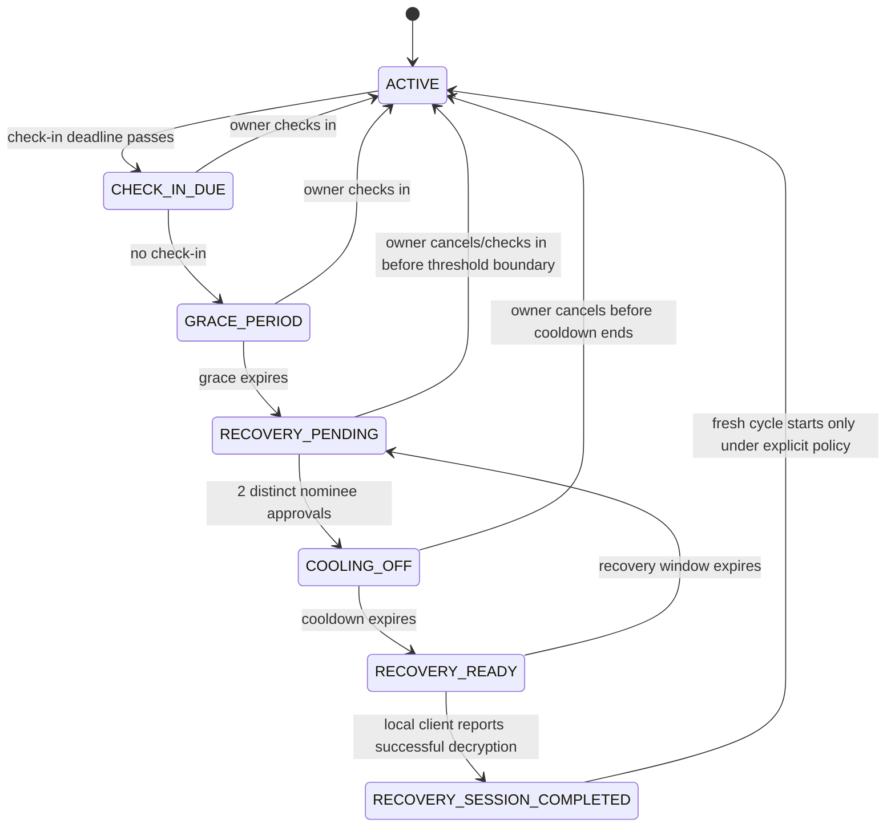

# 04 — Application Flow and Recovery State Machine

## 1. Primary owner flow

1. Landing page explains the product, privacy boundary and non-legal/non-financial scope.
2. Sign up/sign in.
3. Create vault: choose a strong vault passphrase, review the recovery warning and choose check-in cadence.
4. Browser generates DEK, wraps it under passphrase-derived KEK, encrypts empty vault payload, splits DEK 2-of-3 and saves ciphertext envelope.
5. Recovery-card handoff: show one card at a time, export/print, explain that the server cannot retrieve lost shares, ask owner to store each separately with one nominee.
6. Add three nominees and assign each a share-delivery checklist item. Nominee names/emails are operational metadata, not zero-knowledge content.
7. Add synthetic asset entries and claim instructions. Encrypt the complete payload locally and save envelope.
8. Dashboard shows last check-in, next check-in, configured nominees, vault-lock state and audit events.
9. Owner performs check-in to reset timer, or later allows the workflow to enter grace.

## 2. Primary nominee flow

1. Nominee opens invite and authenticates.
2. The interface explains their role, privacy limitations and that approval is not proof of death or legal entitlement.
3. During `RECOVERY_PENDING`, nominee reviews the request and approves or declines.
4. The server records approval, uniquely per nominee and recovery request.
5. Two distinct approvals move the request into `COOLING_OFF`.
6. Nominee waits through cooling-off; the owner can still cancel.
7. After `RECOVERY_READY`, recovery participants use two separately held recovery cards in the recovery browser. The server does not receive the cards.

## 3. Recovery flow

1. Recovery participant opens recovery page for the specific vault.
2. Backend confirms `RECOVERY_READY` and that the unlock window is active.
3. Client fetches encrypted payload envelope and wrapped DEK metadata.
4. Two recovery cards are scanned/imported locally.
5. Client validates card format, vault ID and distinct share indices.
6. Client combines shares locally into DEK.
7. Client decrypts AES-GCM payload with required AAD.
8. If authentication or schema validation fails, display a safe error and don't show partial plaintext.
9. On success, show read-only recovered inventory and instructions. Do not store plaintext remotely. The unlock window expires; a subsequent request requires a new authorized flow according to policy.

## 4. State machine

| State | Entry condition | Allowed next state(s) | Notes |
|---|---|---|---|
| `ACTIVE` | Vault is operational and no missed check-in is overdue. | `CHECK_IN_DUE`, `CANCELLED/REACTIVATED` only by an explicit future policy | Owner may check in or update vault. |
| `CHECK_IN_DUE` | Server time passes check-in due time. | `ACTIVE`, `GRACE_PERIOD` | Notify owner; no nominee release. |
| `GRACE_PERIOD` | Owner has not checked in by due time. | `ACTIVE`, `RECOVERY_PENDING` | Owner check-in resets workflow. Grace period is mandatory. |
| `RECOVERY_PENDING` | Grace expires without check-in. | `ACTIVE` (owner cancellation/check-in policy), `COOLING_OFF` after two unique nominee approvals | No shares may be combined for release until ready. |
| `COOLING_OFF` | Two approvals are valid. | `ACTIVE`/`CANCELLED` via owner cancellation; `RECOVERY_READY` when server time passes deadline | Further approvals do not shorten cooldown. |
| `RECOVERY_READY` | Cooling-off ends. | `RECOVERED`, expiry back to `RECOVERY_PENDING` or equivalent retry state depending on policy | Backend permits retrieval of ciphertext only; key recovery remains client-side. |
| `RECOVERED` | A recovery session successfully decrypts locally and reports completion without sending the key/plaintext. | `RECOVERY_PENDING` for a fresh session or terminal state, per product decision | Audit success is based on client attestation/report, not cryptographic proof to server. Clearly label this limitation. |
| `CANCELLED/REACTIVATED` | Owner successfully cancels during the allowed period. | `ACTIVE` | Invalidates active recovery request/nonces. |

**Important:** `RECOVERED` cannot mean the server verified plaintext decryption, because the server never sees the key or plaintext. Use `RECOVERY_SESSION_COMPLETED` as a client-reported workflow event and label it accordingly, or simply keep the server state as `RECOVERY_READY` and record a client-reported completion event. Prefer the latter for honest semantics.

## 5. Transition rules

- Only server time controls due dates, grace periods, cooldown and unlock expiry.
- The user cannot directly PATCH a state name.
- State transitions run transactionally and compare the expected current state.
- Two approvals mean two distinct active nominee IDs; duplicate approval retries are idempotent.
- Owner check-in during `CHECK_IN_DUE`, `GRACE_PERIOD`, or `RECOVERY_PENDING` can reset to `ACTIVE` before the threshold/cooldown boundary per policy.
- Owner cancellation during `COOLING_OFF` always wins if committed before the transition to `RECOVERY_READY`. Serialize competing transitions in a transaction.
- After `RECOVERY_READY`, cancellation policy requires explicit product/legal review; for the MVP, no new approvals can accelerate release and a live recovery session has a short expiry.
- Fail closed: scheduler or database errors never advance a workflow earlier than its deadline.

## 6. Default timings

- Demo: check-in 2 minutes, grace 2 minutes, cooling-off 2 minutes; a server-gated simulated clock may move through time for judging.
- Non-demo example configuration: check-in monthly, grace 7 days, cooling-off 48 hours. These are illustrative product defaults, not claims of legal safety or proof of absence.
- Recovery session: 24 hours once `RECOVERY_READY`; a fresh request/session is required after expiry.

## 7. Flow diagram

## 8. Demo control panel

A hidden developer/demo area may show:
- current simulated time;
- current state and next deadline;
- “advance to next transition” and “reset demo” controls;
- current approvals (not share values);
- audit verification status.

The simulated-time endpoint must be blocked unless `NODE_ENV !== 'production'` and an explicit server-side demo flag is enabled. Do not use a query string like `?demo=true` as authorization. Never put share material in the timeline or debug panel.
