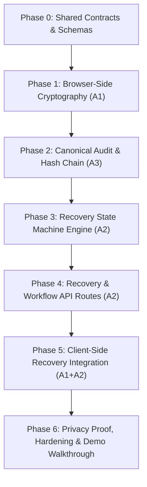

# Last Mile — Implementation Plan (Mayank Sharma: Workstream A)

> **Role:** Team Lead & Core Security/Workflow Owner  
> **Source Baseline:** `Last_Mile_Task_Distribution_Mayank_Shyam.pdf` (Pages 2, 4, 5) & Project Docs (`00` to `10`)  
> **Scope:** Browser-side cryptography, 2-of-3 secret sharing, recovery state machine, audit chain verification, recovery API routes, domain test suite, and privacy proof walkthrough.

---

## Operating Guidelines & File Seams

### Mayank's Ownership Boundary:
- `src/lib/crypto/**` (Web Crypto AES-256-GCM, scrypt KDF, Shamir secret sharing, recovery card parser)
- `src/lib/recovery/**` (Domain state machine, simulated demo clock, transition engine)
- `src/lib/audit/**` (Canonical event hashing, hash chain verification)
- `src/types/**` (Cryptographic envelopes, recovery models, audit schemas, shared API types)
- `src/app/api/vaults/[vaultId]/check-in/route.ts`
- `src/app/api/vaults/[vaultId]/recovery-requests/route.ts`
- `src/app/api/recovery-requests/[requestId]/decision/route.ts`
- `src/app/api/recovery-requests/[requestId]/cancel/route.ts`
- `src/app/api/recovery-requests/[requestId]/session/route.ts`
- `src/app/api/recovery-requests/[requestId]/client-completion/route.ts`
- `src/app/api/internal/advance-workflows/route.ts`
- `src/app/api/dev/demo-clock/route.ts`
- `src/app/api/vaults/[vaultId]/audit/route.ts`
- Comprehensive domain test suite in `src/lib/**/__tests__` and `src/__tests__/api/**`

### Shyam's Boundary (Do Not Modify):
- Supabase migrations (`supabase/migrations/**`) & raw SQL RLS policies
- UI components, app shell, forms, dashboard, asset entry screens, and styling
- Persistence routes: `POST /api/vaults`, `GET /api/vaults/:id`, `PUT /api/vaults/:id/envelope`, `POST /api/vaults/:id/nominees`, `POST /api/invites/accept`

---

## Phased Implementation Roadmap

---

### Phase 0: Shared Contracts, Type Definitions & Schemas
**Objective:** Define the complete typed interface and runtime validation schemas for cryptographic payloads, recovery state, audit events, and API contracts before writing functional logic.

- [ ] **Task 0.1:** Define crypto envelope types and Zod schemas (`src/types/crypto.ts`):
  - `EncryptedPayloadEnvelope`: `schemaVersion`, `cryptoVersion`, `algorithm`, `nonce` (base64url, 12 bytes), `aadVersion`, `ciphertext`.
  - `WrappedKeyEnvelope`: `wrapVersion`, `kdf`, `kdfParams` (N, r, p, dkLen), `salt` (base64url), `algorithm`, `nonce`, `wrappedDek`.
  - `RecoveryCard`: `format`, `formatVersion`, `vaultId`, `shareIndex` (1..3), `threshold` (2), `totalShares` (3), `share` (base64url), `createdAt`.
- [ ] **Task 0.2:** Define recovery state machine types (`src/types/recovery.ts`):
  - `VaultState`: `ACTIVE` | `CHECK_IN_DUE` | `GRACE_PERIOD` | `RECOVERY_PENDING` | `COOLING_OFF` | `RECOVERY_READY` | `RECOVERED` | `CANCELLED`.
  - `RecoveryRequest`, `RecoveryApproval`, `RecoverySession`.
- [ ] **Task 0.3:** Define audit trail types (`src/types/audit.ts`):
  - `AuditEvent`: `id`, `vaultId`, `sequence`, `eventType`, `actorUserId`, `serverTime`, `metadata`, `previousHash`, `eventHash`.
- [ ] **Task 0.4:** Define API request/response contracts (`src/types/api.ts`):
  - Decision payload, check-in response, demo-clock request/response, audit verification response.

**Exit Gate:** Typecheck passes (`npm run typecheck`). Zero runtime dependencies yet.

---

### Phase 1: Workstream A1 — Browser-Side Cryptography Engine
**Objective:** Implement and thoroughly test pure client-side cryptographic primitives using Web Crypto, scrypt, and audited Shamir Secret Sharing.

- [ ] **Task 1.1:** Install vetted crypto dependencies:
  - `@noble/hashes` (for audited scrypt KDF)
  - `shamir-secret-sharing` (Privy's audited 2-of-3 Shamir implementation)
- [ ] **Task 1.2:** Implement low-level Web Crypto AES-256-GCM utilities (`src/lib/crypto/aes.ts`):
  - Generate cryptographically strong 256-bit DEK (`generateDek()`).
  - Generate random 12-byte (96-bit) nonces and salts (`generateRandomBytes(length)`).
  - Encrypt payload with AES-256-GCM and context-bound AAD (`encryptPayload()`).
  - Decrypt payload with AES-256-GCM and verify authentication tag (`decryptPayload()`).
- [ ] **Task 1.3:** Implement scrypt key derivation and DEK wrapping (`src/lib/crypto/kdf.ts` & `src/lib/crypto/wrap.ts`):
  - Derive 256-bit KEK from passphrase and salt using scrypt (`deriveKek(passphrase, salt, params)`).
  - Wrap DEK with KEK using AES-256-GCM and distinct nonce (`wrapDek(dek, kek, vaultId)`).
  - Unwrap DEK with KEK and verify tag (`unwrapDek(wrappedEnvelope, kek, vaultId)`).
- [ ] **Task 1.4:** Implement 2-of-3 Shamir secret sharing (`src/lib/crypto/shamir.ts`):
  - Split 32-byte DEK into 3 shares with threshold 2 (`splitDek(dek)`).
  - Combine 2 distinct valid shares to reconstruct DEK (`combineShares(shares)`).
- [ ] **Task 1.5:** Implement Recovery Card serialization and validation (`src/lib/crypto/recovery-card.ts`):
  - Encode share into versioned Recovery Card JSON format (`encodeRecoveryCard()`).
  - Parse, inspect, and validate Recovery Card (`parseRecoveryCard()`).
  - Validation guards: check format identifier, version compatibility, vault ID matching, non-duplicate share indices, and valid byte lengths.
- [ ] **Task 1.6:** Cryptography Unit & Security Test Suite (`src/lib/crypto/__tests__/crypto.test.ts`):
  - DEK generation randomness & entropy checks.
  - AES-GCM round-trip with synthetic inventory fixtures.
  - Tampered ciphertext rejection (ensuring authentication tag verification).
  - Wrong nonce, corrupted AAD, or wrong vault ID failure.
  - Wrapped DEK round-trip with correct passphrase.
  - Wrong passphrase unwrap failure (generic, non-leaky error).
  - Shamir 2-of-3 reconstruction with all pair combinations: (1,2), (1,3), (2,3).
  - 1-share failure (cannot reconstruct DEK).
  - Duplicate share indices rejection (e.g., share 1 + share 1).
  - Mismatched vault ID cards rejection.
  - Corrupted card or invalid base64url bytes rejection.

**Exit Gate:** All crypto tests pass with 100% coverage on security primitives. Zero secrets leaked to console or storage.

---

### Phase 2: Workstream A3 (Part 1) — Canonical Audit Engine & Hash Chaining
**Objective:** Build the tamper-evident audit log system with deterministic canonicalization and verifiable SHA-256 hash chaining.

- [ ] **Task 2.1:** Implement canonical event serialization (`src/lib/audit/canonical.ts`):
  - Deterministic key sorting and RFC 8785-compliant JSON canonicalization.
  - Strict allowlist filtering on event metadata (disallowing freeform sensitive text).
- [ ] **Task 2.2:** Implement SHA-256 hash chaining (`src/lib/audit/hasher.ts`):
  - Genesis block hash calculation with documented sentinel (`GENESIS_PREVIOUS_HASH`).
  - Calculate `event_hash = SHA256(canonicalPayload + previousHash)`.
- [ ] **Task 2.3:** Implement hash chain verifier (`src/lib/audit/verifier.ts`):
  - Validate sequential integrity (`sequence = sequence + 1`).
  - Validate hash linkage (`current.previousHash === prior.eventHash`).
  - Return clear, structured verification report: `{ valid: boolean, brokenIndex?: number, errorReason?: string }`.
  - Include documentation comments on limitations: tamper-evident when an independent checkpoint is retained, but does not defeat a fully privileged operator rewriting the entire database.
- [ ] **Task 2.4:** Audit Unit Tests (`src/lib/audit/__tests__/audit.test.ts`):
  - Genesis event calculation.
  - Valid multi-event chain verification.
  - Modified event metadata detection (hash mismatch).
  - Reordered, skipped, or duplicated sequence detection.
  - Disallowed metadata fields rejection.

**Exit Gate:** Audit suite passes with tamper-detection verification verified.

---

### Phase 3: Workstream A2 (Part 1) — Recovery State Machine Engine & Demo Clock
**Objective:** Implement server-authoritative workflow transition logic, approval thresholds, cooling-off countdowns, cancellation rules, and the simulated demo clock.

- [ ] **Task 3.1:** Implement pure domain state transition engine (`src/lib/recovery/state-machine.ts`):
  - Transition guards:
    - `ACTIVE` → `CHECK_IN_DUE` (when `currentTime > nextCheckInAt`)
    - `CHECK_IN_DUE` → `ACTIVE` (on owner check-in)
    - `CHECK_IN_DUE` → `GRACE_PERIOD` (when check-in deadline elapsed)
    - `GRACE_PERIOD` → `ACTIVE` (owner check-in during grace resets process)
    - `GRACE_PERIOD` → `RECOVERY_PENDING` (when `currentTime > graceEndsAt`)
    - `RECOVERY_PENDING` → `COOLING_OFF` (triggered strictly when distinct approvals == 2)
    - `COOLING_OFF` → `ACTIVE` (on authenticated owner cancellation)
    - `COOLING_OFF` → `RECOVERY_READY` (when `currentTime > coolingOffEndsAt`)
    - `RECOVERY_READY` → `RECOVERY_PENDING` / Expired (when `currentTime > unlockExpiresAt`)
- [ ] **Task 3.2:** Implement approval threshold calculator (`src/lib/recovery/approvals.ts`):
  - Deduplicate approvals: each active nominee ID can vote at most once.
  - Decline handling: does not advance threshold; records audit event.
  - Enforce threshold: exactly 2 distinct active nominee approvals required.
- [ ] **Task 3.3:** Implement server-gated Demo Clock (`src/lib/recovery/demo-clock.ts`):
  - Non-production guard: strictly rejected if `process.env.NODE_ENV === 'production'` or `NEXT_PUBLIC_DEMO_MODE !== 'true'`.
  - Simulate advancing time to specific milestones (`advanceToNextDue()`, `advanceSeconds(n)`).
  - Reset demo state utility for repeated hackathon rehearsals.
- [ ] **Task 3.4:** State Machine & Concurrency Tests (`src/lib/recovery/__tests__/state-machine.test.ts`):
  - Normal happy path from `ACTIVE` to `RECOVERY_READY`.
  - Owner check-in during `CHECK_IN_DUE` and `GRACE_PERIOD` resets timers.
  - Approval by Nominee A (1/2) -> duplicate approval by Nominee A rejected/idempotent (still 1/2).
  - Approval by Nominee B (2/2) -> initiates cooling-off.
  - Owner cancellation during `COOLING_OFF` reverts state to `ACTIVE` and invalidates pending request.
  - Cancellation vs. cooling-off expiry race conditions: cancellation committed before transition wins; fail-closed behavior.
  - Client attempting to skip states directly is rejected.
  - Demo clock blocked when demo mode is turned off.

**Exit Gate:** 100% passing state machine and transition concurrency tests.

---

### Phase 4: Workstream A2 (Part 2) — Recovery & Workflow API Handlers
**Objective:** Expose the secure API endpoints according to `06_API_CONTRACT.md` with authorization, transactional integrity, rate limiting headers, and zero secret leakage.

- [ ] **Task 4.1:** Implement Check-in Route:
  - `POST /api/vaults/[vaultId]/check-in`: Authenticated owner check-in; recomputes `next_checkin_at`, resets state if due/grace, appends audit event.
- [ ] **Task 4.2:** Implement Recovery Request Lifecycle Routes:
  - `POST /api/vaults/[vaultId]/recovery-requests`: Starts or retrieves pending request when grace conditions are met.
  - `POST /api/recovery-requests/[requestId]/decision`: Nominee records `approve` or `decline`. Idempotency key guarded; updates distinct count transactionally; transitions to `COOLING_OFF` at count 2.
  - `POST /api/recovery-requests/[requestId]/cancel`: Authenticated owner cancels pending recovery during permitted window; invalidates sessions; appends audit event.
  - `GET /api/recovery-requests/[requestId]/session`: Serves ciphertext envelope and session status to authorized nominee/owner *only* after `RECOVERY_READY`. Contains `Cache-Control: no-store`. Never serves shares.
  - `POST /api/recovery-requests/[requestId]/client-completion`: Client attestation that local decryption succeeded (`client_reported_recovery_complete`).
- [ ] **Task 4.3:** Implement Workflow Scheduler & Demo Clock Routes:
  - `POST /api/internal/advance-workflows`: Server-only job route to transition due workflows based on authoritative server time.
  - `POST /api/dev/demo-clock`: Server-gated demo control to advance simulated time for hackathon judging.
- [ ] **Task 4.4:** Implement Audit Read Route:
  - `GET /api/vaults/[vaultId]/audit`: Returns verified audit event sequence and chain status for authorized viewers.
- [ ] **Task 4.5:** API Route Tests (`src/__tests__/api/recovery-routes.test.ts`):
  - Request validation and oversized payload rejection.
  - Forbidden operations (e.g. non-nominee attempting approval).
  - State guards (e.g. attempting to fetch recovery session before `RECOVERY_READY`).
  - Cache-Control header verification (`no-store` on sensitive endpoints).

**Exit Gate:** All route handlers return expected contract shapes and pass automated route tests.

---

### Phase 5: Workstream A1/A2 Integration — High-Level Client Orchestrators
**Objective:** Provide ready-to-use, bulletproof client-side orchestrator functions so Shyam’s UI screens can invoke encryption, unlocking, and recovery in 1 line of clean code without touching crypto primitives directly.

- [ ] **Task 5.1:** Vault Creator Orchestrator (`src/lib/crypto/vault-creator.ts`):
  - `createVaultPackage(passphrase: string, initialAssets: AssetPayload)`:
    1. Generates 256-bit DEK.
    2. Derives KEK via scrypt.
    3. Wraps DEK with KEK.
    4. Encrypts assets with DEK.
    5. Splits DEK into 3 Shamir shares.
    6. Formats 3 Recovery Cards.
    7. Returns `{ payloadEnvelope, wrappedKeyEnvelope, recoveryCards }`.
    8. Clears raw key buffers from memory as best effort.
- [ ] **Task 5.2:** Owner Unlock Orchestrator (`src/lib/crypto/vault-unlock.ts`):
  - `unlockVault(passphrase: string, wrappedKeyEnvelope, payloadEnvelope)`:
    1. Derives KEK.
    2. Unwraps DEK (verifies tag).
    3. Decrypts payload (verifies tag).
    4. Returns parsed plaintext assets.
- [ ] **Task 5.3:** Nominee Recovery Orchestrator (`src/lib/recovery/recovery-orchestrator.ts`):
  - `recoverVault(cardAString: string, cardBString: string, payloadEnvelope)`:
    1. Parses and validates both cards (checks matching vault ID, different share indices).
    2. Combines shares to reconstruct DEK.
    3. Decrypts payload envelope locally.
    4. Returns read-only recovered inventory.
- [ ] **Task 5.4:** End-to-End Orchestrator Integration Tests (`src/__tests__/integration/orchestration.test.ts`):
  - Full simulated user journey: Create Vault → Generate 3 Cards → Unlock as Owner → Simulate Inactivity → Recover with Cards 1 & 3 → Decrypt successfully.

**Exit Gate:** Full integration test passes end-to-end in Node/browser test environment.

---

### Phase 6: Privacy Proof, Hardening & Demo Walkthrough Script
**Objective:** Perform final verification of all security boundaries, verify network payloads, and prepare the technical walkthrough.

- [ ] **Task 6.1:** Zero-Plaintext Audit & Privacy Verification:
  - Run network and state inspection tests: assert that no JSON payload sent to any route contains `plaintext`, `passphrase`, `rawKey`, `dek`, `kek`, or `share`.
  - Verify that no credentials or shares are stored in `localStorage` or `sessionStorage`.
- [ ] **Task 6.2:** Full Quality Gate Execution:
  - `npm run lint` — 0 errors/warnings.
  - `npm run typecheck` — 0 errors.
  - `npm run test` — all unit, integration, and security tests pass.
  - `npm run build` — Next.js production build succeeds.
- [ ] **Task 6.3:** Technical Walkthrough & Demo Guide:
  - Prepare concise 2-minute demo flow for judges (explaining the 3 trust zones, displaying database ciphertext view, advancing demo clock, 2-card unlock, and cancellation proof).

---

## Task Summary & Phase Sequence

| Phase | Focus Area | Key Deliverables | Estimated Tests |
|---|---|---|---|
| **Phase 0** | Contract & Type Seams | `src/types/*.ts` (crypto, recovery, audit, api) | Typecheck validation |
| **Phase 1** | Browser Cryptography (A1) | AES-GCM, scrypt KDF, Shamir 2-of-3, recovery cards | ~15 unit/security tests |
| **Phase 2** | Canonical Audit Trail (A3) | Canonical JSON, SHA-256 chain, verification engine | ~8 unit tests |
| **Phase 3** | State Machine Engine (A2) | Domain transitions, approval deduplication, demo clock | ~12 state tests |
| **Phase 4** | Recovery API Handlers (A2) | Check-in, recovery request, decision, cancel, demo routes | ~10 route tests |
| **Phase 5** | Integration Orchestrators | `createVaultPackage`, `unlockVault`, `recoverVault` | ~6 e2e integration tests |
| **Phase 6** | Security Proof & Hardening | Zero-leakage assertions, clean build, demo walkthrough | Full regression pass |

---

## Definition of Done (Security & Hackathon Acceptance)
1. **Zero Secret Leakage:** Database and network traffic contain only ciphertext envelopes and permitted metadata.
2. **2-of-3 Cryptographic Integrity:** 1 share fails; 2 valid shares from the same split recover the vault; invalid/duplicate/mismatched shares fail cleanly without leaking partial plaintext.
3. **State Machine Correctness:** 2 distinct nominee approvals are strictly required; duplicate approvals count once; owner cancellation during cooling-off reliably aborts recovery.
4. **Tamper-Evident Audit:** Tampering with any historical audit event causes verification failure against prior hash checkpoints.
5. **Quality Gates:** 100% green on `lint`, `typecheck`, `test`, and `build`.
